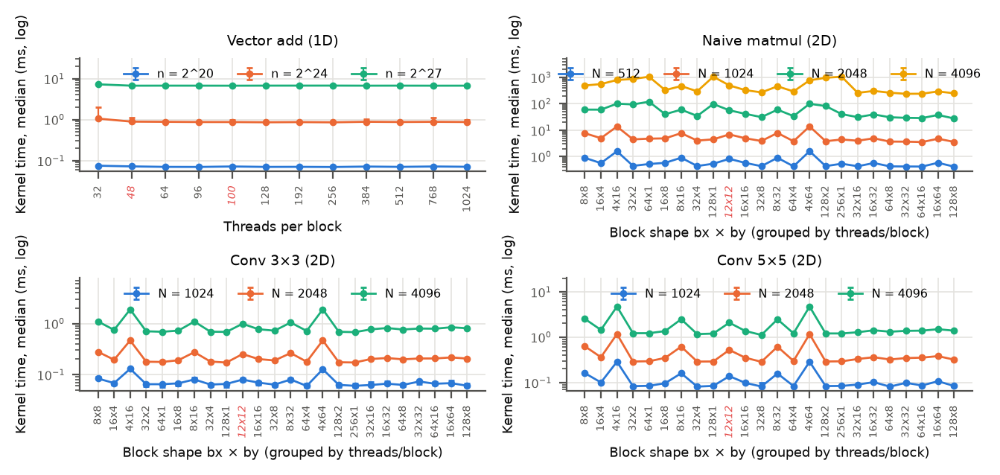
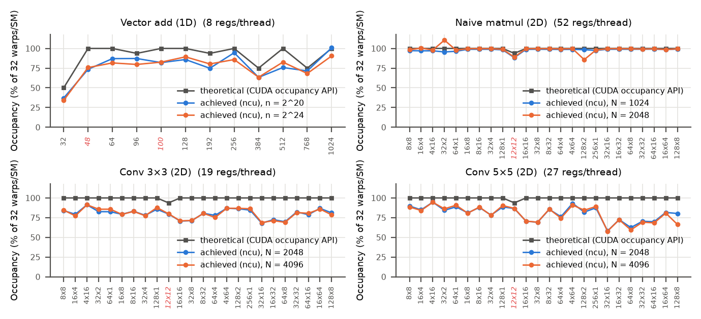
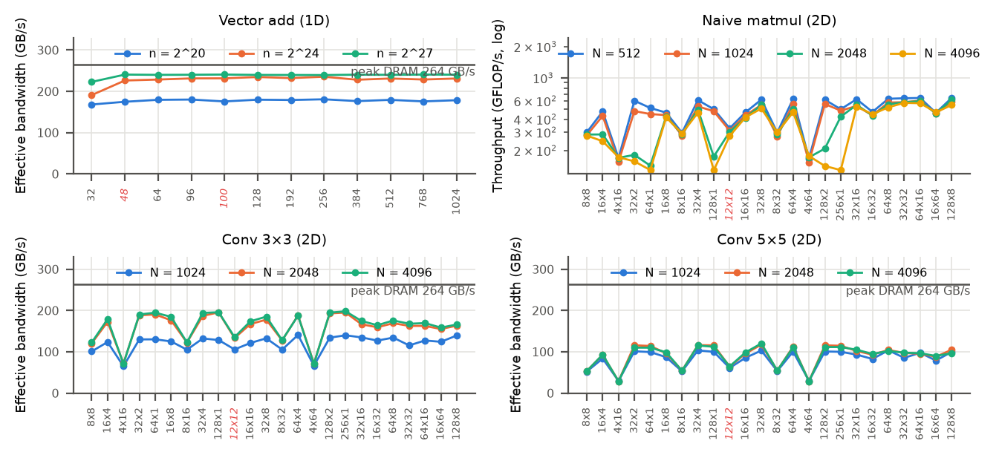
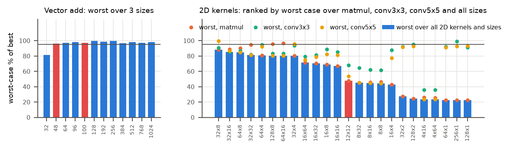

## 1. Problem, research question and related work

Block size is usually chosen by habit (256 threads, 16×16). We ask **which configuration is robust across workload sizes**, i.e. keeps a high *worst-case* fraction of the per-size optimum. Roofline [1] and Hong and Kim's MLP/TLP model [2] treat occupancy as a means of hiding latency, not a goal, and Volkov [3] showed that faster libraries often use *smaller* blocks at *lower* occupancy. Turing's hierarchy was characterised in [4]; hierarchical (L1/L2/DRAM) rooflines [5] frame our cache analysis. Recent work treats launch parameters as one dimension of an interrelated space needing auto-tuning [6], benchmarks the search algorithms [7, 9] and adds clock/energy objectives [8]; a tuned optimum is only useful if it transfers, which is what robustness measures.

## 2. Setup, protocol and metrics

**Platform.** RTX 2060 laptop GPU (Turing CC 7.5, 30 SMs, ≤1024 threads and ≤16 blocks per SM, 64 K registers/SM, 3 MB L2; `results/raw/device_info.json`). Peak DRAM bandwidth is 264 GB/s (queried 5501 MHz × 192-bit); peak FP32 is 5.93 TFLOP/s at the median loaded SM clock of 1545 MHz (`peaks_used.csv`). Host: Ryzen 7 3750H, Windows 11 WDDM driver 581.57, PCIe Gen3 ×8. CUDA 12.9.1, MSVC 19.44, Nsight Compute 2025.2.1; `-O3 -arch=sm_75 -lineinfo`.

**Workloads (baseline = naive kernels).** Vector add (*n* = 2^20, 2^24, 2^27); naive SGEMM (*N* = 512–4096; a shared-memory tiled version is a secondary comparison only); 2D convolution with 3×3 and 5×5 filters (1024²–4096²). Sweep: 12 1D block sizes (32–1024, plus wasteful 48 and 100) and 24 2D shapes, including equal-thread families (16×16, 32×8, 8×32, 64×4, 4×64, 256×1) and 12×12. threadIdx.x maps to the contiguous dimension. All 288 (kernel, size, configuration) points passed a check against a CPU reference (`configs.csv`).

**Protocol.** Each configuration got 5 discarded warm-ups, then 50 timed runs (30 for naive matmul) with cudaEvent kernel-only timing. **Configuration order was reshuffled every repetition** so thermal drift hits all configurations alike. Clocks, temperature and power were logged every 500 ms, giving 12,480 raw rows (`kernel_times.csv`). Copies, launch and sync costs were timed separately; Nsight Compute profiled all configurations at two sizes per kernel.

**Metrics.** We report median time with a distribution-free 95% CI, CV and IQR. Throughput is GB/s from compulsory bytes (12*n*; conv 8*N*²) or GFLOP/s (2*N*³; conv 2*K*²*N*²). *Speedup*: vs a single-thread CPU baseline (kernel-only and end-to-end) and vs the default configuration (256 / 16×16). *Efficiency*: % of roofline peak. Classic speedup/#processors is ill-defined here: 30 SMs, 1920 lanes and 960 resident warps, and latency hiding *requires* oversubscription. *Robustness*: worst-case and mean of (best median ÷ own median) across sizes.

## 3. Results

{width=82%}

: **Table 1.** Best configuration per kernel and size. Peaks: 264 GB/s, 5.93 TFLOP/s. "vs. default" compares against 256 / 16×16. End-to-end includes pageable copies (`results/processed/summary_table_compact.md`).

| Kernel | Size | Best | Median ms [95% CI] | Throughput (% peak) | vs. default | vs. CPU (kernel / e2e) |
|-----|-----|-----|-------------------|----------------|-------|-----------|
| conv3 | 1024² | 64x4 | 0.0596 [0.05734, 0.06576] | 140.7 GB/s (53.3%) | 1.16× | 536× / 17.1× |
| conv3 | 2048² | 128x1 | 0.1717 [0.1707, 0.1724] | 195.4 GB/s (74.0%) | 1.17× | 706× / 19.1× |
| conv3 | 4096² | 256x1 | 0.678 [0.6763, 0.6848] | 198.0 GB/s (75.0%) | 1.14× | 735× / 20.5× |
| conv5 | 1024² | 64x8 | 0.08107 [0.07987, 0.08602] | 103.5 GB/s (39.2%) | 1.21× | 694× / 28.6× |
| conv5 | 2048² | 32x8 | 0.2859 [0.2847, 0.2966] | 117.4 GB/s (44.4%) | 1.23× | 1038× / 45.2× |
| conv5 | 4096² | 32x8 | 1.116 [1.107, 1.126] | 120.2 GB/s (45.5%) | 1.22× | 1162× / 50.6× |
| matmul | 512² | 128x8 | 0.4162 [0.4157, 0.4195] | 645.0 GFLOP/s (10.9%) | 1.38× | 78× / 24.7× |
| matmul | 1024² | 64x16 | 3.55 [3.518, 3.652] | 605.0 GFLOP/s (10.2%) | 1.39× | 86× / 49.3× |
| matmul | 2048² | 128x8 | 27.79 [27.64, 28.44] | 618.2 GFLOP/s (10.4%) | 1.49× | 121× / 86.4× |
| matmul | 4096² | 32x32 | 238.7 [236, 242] | 575.7 GFLOP/s (9.7%) | 1.38× | 131× / 113× |
| vecadd | 2^20 | 256 | 0.06963 [0.06963, 0.0703] | 180.7 GB/s (68.4%) | 1.00× | 14× / 0.358× |
| vecadd | 2^24 | 256 | 0.8556 [0.8533, 0.8827] | 235.3 GB/s (89.1%) | 1.00× | 17× / 0.402× |
| vecadd | 2^27 | 100 | 6.694 [6.685, 6.706] | 240.6 GB/s (91.1%) | 1.01× | 18× / 0.436× |

{width=82%}

{width=82%}

{width=82%}

**Answer to the research question** (`robustness.csv`, `robustness_cross_kernel_2d.csv`). For vector add, every multiple of 32 from 64 to 1024 threads stays within 4% of the optimum, and 256 is the most robust (worst 99.5%). For 2D kernels the most robust single shape is **32×8**: worst 88.2%, mean 94.2% over all ten kernel–size points. Per kernel, 64×16 is best for matmul (worst 96.5%), 256×1 for conv 3×3 (99.4%) and 32×8 for conv 5×5 (99.5%). The default 16×16 drops to 66.9–72.6% for matmul and 81.5–87.8% for convolution; the best configuration beats it by 1.14–1.49×. The worst shapes reach only 22.5% (64×1, matmul) and 23.7% (4×64, conv 5×5). For matmul, rankings are unchanged when only the second half of the repetitions is used (Spearman ρ ≥ 0.996). For convolution and vector add, near-tied winners swap (`sensitivity_steady_state.csv`). The robust answer is therefore a *set*: blockDim.x ≥ 32, 256–1024 threads, and blockDim.y ≥ 8 for matmul.

## 4. Discussion

**Coalescing ranks the 2D shapes.** A warp in a 32-wide block reads one 128 B row segment. A 4-wide block spreads it over 8 rows, so matmul uses only 16.7% of each fetched sector (82.5% for 64×16). The result is 97.3 versus 19.5 warps stalled on LSU throttling per issued instruction (*N* = 2048, `ncu_explained.csv`). 16×16 sits in between (56.3%, 28.9): mediocre everywhere.

**Cache reuse sets the block height.** Flat blocks suit convolution but ruin matmul at large *N*: 256×1 falls from 77.5% of best (*N* = 512) to 22.5% (4096), and 32×2 from 93.6% to 27.3%. With *by* = 1 no two rows in a block share the B columns they stream. L1 hit rate drops from ≈90% to ≈19%, and DRAM traffic rises to 348–616× the compulsory bytes (25–48× for 32×32, 64×16, 128×8), saturating DRAM. Block shape alone moves the kernel between roofline levels [5]. Convolution stays at 0.99–1.47× compulsory DRAM traffic for every shape. Its narrow shapes saturate L1 instead (up to 99.9%), so only coalescing matters there.

**Occupancy does not explain the ranking** (Fig. 2, `occupancy_correlation.csv`). With 19–52 registers per thread and no shared memory, every warp-multiple 2D shape has 100% theoretical occupancy. Achieved occupancy tracks performance only for streaming vector add (r = 0.89, 0.92). It is uncorrelated for matmul (r = 0.26, 0.07) and *negatively* correlated for conv 5×5 (r = −0.48, p = 0.02; r = −0.46, p = 0.03): 32×8 runs at 69% occupancy, while 4×64, among the slowest, runs at 91%, as Volkov argued [3]. Occupancy matters only at the extreme: 32-thread blocks hit Turing's 16-blocks/SM cap (50% theoretical, 34–37% achieved), and DRAM throughput falls to 51–53% (81.1% of best at 2^24). Non-warp-multiples (48, 100) waste lanes, but vector add is so DRAM-bound that they still reach ≥96% of best.

**Roofline and overheads.** Vector add reaches 89–91% of peak bandwidth. Convolution reaches 39–75%, since its halo re-reads hit L1/L2. Naive matmul reaches 9.7–10.9% of FP32 peak; tiled 32×32 is 1.24–1.40× faster, but tiled 8×8 is slower (0.74–0.81×), so block size still matters after optimisation. Data movement dominates the streaming kernels: the kernel is 2.3–2.6% of end-to-end time for vector add (2.7–4.4% for conv, 32–86% for matmul). Vector add is thus *slower* than the CPU end-to-end (0.36–0.44×; pinned H2D 6.5 GB/s). WDDM launch overhead is 25–27 µs (launch+sync 34.8 µs; idle sync 0.79 µs, `overhead_summary.csv`), comparable to the 70 µs 2^20 vector add itself. Block scheduling costs ≈1.3 ns per block: an empty 2^24-thread grid needs at least 658 µs with 32-thread blocks versus 91 µs with 256, and its median is 4–5× higher because of low-power states. Tail effects are negligible (every grid spans ≥ 8.5 waves).

## 5. Limitations and threats to validity

(i) **Throttling:** during the matmul sweep the power cap was active in 916 of 999 busy samples, and the SM clock ranged from 1170 to 1875 MHz (`gpu_clock_summary.csv`). Interleaving protects *relative* results; absolute GFLOP/s depend on clock (clock locking needs admin rights). (ii) **P-state transients:** early repetitions of some runs were 1.3–4× slower, and ≈10% step changes occurred mid-run. 333 of 12,480 rows exceed 1.5× their median (median CV 6.5%, IQR/median 4.0%), hence medians and the steady-state check. (iii) One GPU, one OS, and WDDM's unusually high launch overhead. (iv) Naive FP32 kernels only, and 3–4 sizes per kernel. (v) ncu replays at base clocks with flushed caches, so its metrics explain but are not timings (achieved occupancy can exceed 100%). (vi) The CPU baseline is single-threaded MSVC `/O2`. (vii) Shape preference depends on the x = contiguous index mapping.

## 6. Future research directions

1. **Model-guided auto-tuning with transfer:** use Kernel Tuner-style search [7, 9], seeded by ncu coalescing and reuse features, and test transfer across sizes and GPUs.
2. **Clock- and energy-aware configuration:** sweep at locked and varied clocks to see how throttling reorders configurations, and optimise energy per result [8].
3. **ILP and data reuse beyond occupancy:** add thread coarsening and halo-tiled convolution to test Volkov's low-occupancy hypothesis [3] with the same robustness metric.

## References

::: {custom-style="Bibliography"}
[1] S. Williams, A. Waterman, D. Patterson, "Roofline: An Insightful Visual Performance Model for Multicore Architectures," *Commun. ACM* 52(4):65–76, 2009. doi:10.1145/1498765.1498785

[2] S. Hong, H. Kim, "An Analytical Model for a GPU Architecture with Memory-level and Thread-level Parallelism Awareness," *Proc. ISCA*, pp. 152–163, 2009. doi:10.1145/1555754.1555775

[3] V. Volkov, "Better Performance at Lower Occupancy," GPU Technology Conference, 2010. https://www.nvidia.com/content/GTC-2010/pdfs/2238_GTC2010.pdf

[4] Z. Jia, M. Maggioni, J. Smith, D. P. Scarpazza, "Dissecting the NVidia Turing T4 GPU via Microbenchmarking," arXiv:1903.07486, 2019.

[5] C. Yang, T. Kurth, S. Williams, "Hierarchical Roofline Analysis for GPUs," *Concurrency Computat. Pract. Exper.* 32(20):e5547, 2020. doi:10.1002/cpe.5547

[6] P. Hijma, S. Heldens, A. Sclocco, B. van Werkhoven, H. E. Bal, "Optimization Techniques for GPU Programming," *ACM Comput. Surv.* 55(11):239, 2023. doi:10.1145/3570638

[7] R. Schoonhoven, B. van Werkhoven, K. J. Batenburg, "Benchmarking Optimization Algorithms for Auto-Tuning GPU Kernels," *IEEE Trans. Evol. Comput.* 27(3):550–564, 2023. doi:10.1109/TEVC.2022.3210654

[8] R. Schoonhoven, B. Veenboer, B. van Werkhoven, K. J. Batenburg, "Going Green: Optimizing GPUs for Energy Efficiency through Model-Steered Auto-Tuning," *PMBS Workshop (SC22)*, pp. 48–59, 2022. doi:10.1109/PMBS56514.2022.00010

[9] J. O. Tørring, B. van Werkhoven, F. Petrovič, F.-J. Willemsen, J. Filipovič, A. C. Elster, "Towards a Benchmarking Suite for Kernel Tuners," *IEEE IPDPSW*, pp. 724–733, 2023. doi:10.1109/IPDPSW59300.2023.00124
:::
